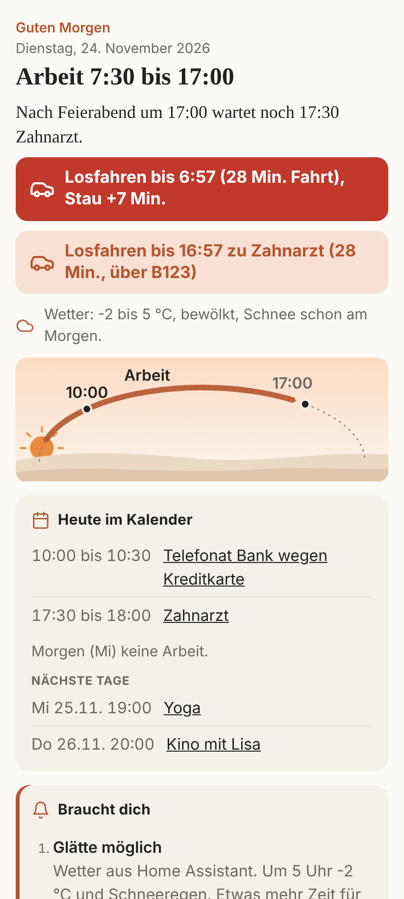

# Morgenbrief: a daily morning brief as a Home Assistant add-on

> **Outdated (26 Nov 2026):** This repository is a snapshot from around version 1.6 and is no longer updated. The add-on has since been developed further locally (now version 2.4, renamed "Tagesbrief"). Issues and pull requests here are not monitored.

Every morning at a fixed time this add-on reads my Google Calendar and Gmail, sorts what matters, checks traffic and weather, and sends a push notification to my phone via the Home Assistant companion app. Tapping it opens a full page inside Home Assistant (Ingress).

The UI and the code comments are in German, because I am. The screenshots below are generated from made-up demo data.



## What the brief shows

- **Day status:** work hours, short day, vacation, public holiday, day off, derived from calendar entries ("Urlaub", "Kurztag") and a holiday calculation
- **Departure time** for the commute with live traffic (TomTom), plus a warning on top if there is a jam or road closure on the usual route
- **Weather** from the Home Assistant weather entity, with an ice warning on commute days
- **"Braucht dich" (needs you):** mails that cost me something if I ignore them until tomorrow, bills I have to pay myself, deadlines, overlapping appointments, appointments during work hours, birthdays
- **Appointments found in mails** that are not in the calendar yet, with a one-tap "add to calendar" link
- **Open to-dos** with due dates, overdue items marked
- **"Demnächst" (coming up):** deadlines further out, like contract renewals
- **Waiting for reply:** mails I sent 3 to 30 days ago that nobody answered
- **Already handled / left out:** with the reason, so nothing disappears silently
- A small header graphic: sunrise arc over the day with work hours and appointment times

## How it works

```
Google Calendar ─┐
Gmail (read-only)┼─> fixed rules (Python) ──> brief.json ──> HTML page (Ingress)
TomTom traffic ──┤        │                          └──> push via notify.mobile_app_*
HA weather ──────┘        └─> Gemini (only to classify new mails, JSON schema)
```

- **Rules first, LLM second.** Day status, bills, deadlines, payment confirmations, traffic and calendar logic are plain rules. Gemini (free tier, Flash-Lite) is only asked to classify new mails into fixed categories and write one short sentence each. If Gemini is down or over quota, the brief still comes, just without that sorting.
- **Each mail goes to Gemini only once.** Results are cached in SQLite, so a normal run sends 0 to 20 mails.
- **Memory:** items under "needs you" stay until they are actually done (I replied, archived the mail, a payment confirmation with the same invoice number arrived, or I tapped "done"), not just for 48 hours.
- **Prompt injection hardening:** Gemini can only return values from a JSON schema. Hard rules override Gemini. Mails that contain instructions to an AI are moved to "left out" and flagged. Links in the brief only ever point to Gmail, Google Calendar or Google Maps, never to URLs from mails or from the model.
- **Minimal permissions:** `gmail.readonly`, `calendar.readonly` and `calendar.app.created`, which only allows writing to the one calendar the add-on created itself (used to remember what I marked as done).
- **No extra dependencies:** standard library only, on the official Python Alpine image.

## Try it without any accounts

```
python3 demo/demo.py
```

Builds a complete brief from invented mails, appointments, traffic and weather and writes `demo/ausgabe/brief.html`. No Google, Gemini, TomTom or Home Assistant needed.

## Install as a local add-on

1. Copy this folder to `/addons/morgenbrief` on your Home Assistant host (Samba or SSH add-on).
2. Settings, Add-ons, Add-on Store, menu, "Check for updates", then install "Morgenbrief" under local add-ons.
3. Create your own Google Cloud project with an OAuth client of type "Desktop app", enable the Gmail and Calendar APIs, and enter client ID and secret in the add-on options. Optional: Gemini key from Google AI Studio, TomTom key from developer.tomtom.com.
4. Start the add-on, open the "Morgenbrief" panel, page "Einrichtung", and connect your Google account.

All options are described in `DOCS.md` (German).

## Known limitations

- Work hours and work days are hardcoded in `app/tage.py` (Mon, Tue, Thu, Fri 7:30 to 17:00), public holidays are Bavarian.
- German UI and German regex rules for bills and deadlines.
- The to-do list comes from calendar entries whose description starts with "Aus der To-do-Liste:". In my setup a separate nightly job writes them. The brief warns if that job has not run for 26 hours.
- `app/brief.py` is about 2,000 lines and grew feature by feature. It works, but it would benefit from splitting.

## How it was built

I am not a professional developer. I defined the features and rules and run it daily on my own data; the code itself was written with Claude (Anthropic). There are test scripts with simulated Gmail, Calendar, Gemini and TomTom responses, but they are modeled on my real mails, so they are not part of this repo. The demo script uses the same approach with invented data.

## License

No license is granted. You are welcome to read the code and take ideas from it, but please don't copy or redistribute it without asking. Provided as is, without any warranty.
